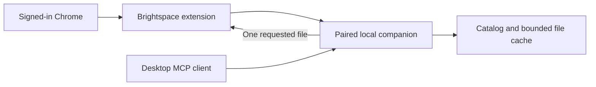

# Brightspace Context

Browse NYU Brightspace courses by semester and module, search resource titles and module notes, and retrieve individual course files through a paired local companion and desktop MCP client.

The Chrome extension uses the browser's existing Brightspace session. It keeps the course hierarchy locally and downloads files on demand. The publisher operates no hosted course-data service. This project is independent of NYU and D2L.

[Setup and Windows download](https://brightspace-context.khin101.chatgpt.site/setup/) · [Privacy policy](https://brightspace-context.khin101.chatgpt.site/) · [Roadmap](docs/ROADMAP.md) · [Release checklist](docs/RELEASE-CHECKLIST.md)

## Current status

The Windows x64 preview is available from the setup page. Chrome Web Store submission is pending; the preview extension uses Chrome's **Load unpacked** flow. Desktop MCP registration is manual. The source checkout can include improvements newer than the downloadable preview.

| Capability | Status |
| --- | --- |
| Semester/course discovery and nested module hierarchy | Implemented; live-tested in Chrome |
| Module notes, readings and links through MCP | Implemented; live-tested |
| Individual browser Download / Save as | Accessible NYU-hosted file formats supported |
| On-demand MCP retrieval and local cache | PDF, PPTX and DOCX supported |
| MCP semester discovery and catalog refresh | Implemented in source; real background-worker/MCP integration tests pass; live acceptance pending |
| Answers using actual PDF contents | Live-tested with a local desktop client |
| PPTX/DOCX file handoff | Worker, byte-equality, MIME-type and packaged-runtime tests pass; real host reading still needs acceptance testing |
| Firefox, other Brightspace tenants, Mac/Linux installers | Not yet supported as tested releases |

Account-switch isolation, queued-request cancellation and in-app cache deletion remain unfinished. This is a single-account local preview. Closing or disconnecting the browser does not erase saved companion data.

## Install the Windows preview

Follow the [public setup guide](https://brightspace-context.khin101.chatgpt.site/setup/). It provides the installer and SHA-256 checksum. The installer includes Node, the companion, the MCP server and an extension copy.

1. Install and start **Brightspace Context Companion** from the Start menu. Keep its window open.
2. Open the installed **Setup guide** for the extension folder, then load it in Chrome at `chrome://extensions`. Keep one extension copy active.
3. Sign into NYU Brightspace in that Chrome profile and pair the extension with the companion's code.
4. Open **Browse resources**, select a semester and choose **Sync semester**.
5. Add the local STDIO MCP server to a supported desktop client using the installed guide's exact Command and Argument, then restart that connection.

Ask the connected client to find a resource, retrieve it and read the actual file before answering. A successful download or a resource title does not establish that the client has read its contents. File reading depends on the host's tools.

## Run from source

Use Node.js 22+ and Chrome 116+:

```text
npm ci
npm run companion
```

Load this repository's `extension/` folder as an unpacked Chrome extension, sign into Brightspace and pair it with the source companion. Resources contains semester sync, course browsing, nested folders, notes, search and downloads.

For desktop MCP, configure a STDIO process using your Node executable and the absolute path to `mcp/start.js` as its argument. Run it on the same computer as the companion. `npm run mcp` starts that server for development; protocol messages use stdout, so it is not an interactive terminal command.

The updated MCP exposes `request_catalog_sync` and `get_catalog_sync`. A model can discover semesters, refresh one semester's course outlines and module notes, then search and request individual files without opening the extension UI. Chrome must be running with the paired extension and a valid Brightspace session. [Catalog-sync workflow and acceptance steps](docs/MCP-CATALOG-SYNC.md).

Searches match completed words and allow the final word to be unfinished, such as `if i ha` for “If I had…”. Single letters match standalone words. Notes match and highlight only passages containing all query terms; unrelated lines remain plain context. Only branches leading to relevant files or notes open automatically. A match in a folder's own title leaves it collapsed unless there is a deeper result. The deepest direct match gets soft row emphasis while ancestor folders remain visible for context.

## How it works



- **Catalog:** fixed NYU endpoints discover semesters, courses and recursive outlines. Descriptions already present are reused; missing module descriptions use the module metadata endpoint. Scanning does not expand webpage modules or bulk-download files.
- **Retrieval:** MCP resolves one stable catalog key and queues a request. The paired Chrome worker fetches it through its browser session. Passwords and cookie values are not read or exported to the companion.
- **Cache:** original PDF/PPTX/DOCX bytes, a 50 MiB per-file limit, a shared 500 MiB LRU budget, freshness checks and SHA-256 verification. PDF headers and bounded Office manifests are checked before accepting files.
- **Handoff:** MCP returns original bytes through a resource link without creating a plaintext file by default. Clients requiring a path can use the explicitly enabled temporary-export feature. No OCR, conversion or document-text indexing is performed. Module notes are available directly as source text.

The companion binds to `127.0.0.1:47653` and checks the paired extension origin and token. Browser pairing and desktop MCP registration are separate connections.

## Local data and privacy

Catalogs are stored in Chrome and the paired companion. The Windows cache defaults to `%USERPROFILE%/BrightspaceContext/cache`; source runs on Unix use `XDG_CACHE_HOME` or `~/.cache/brightspace-context`. `BRIGHTSPACE_CACHE_DIR` overrides the directory. `BRIGHTSPACE_COMPANION_PORT` overrides the service/MCP port when consistently configured.

The v0.9.2 source encrypts persistent companion data with AES-256-GCM and a Windows-account-protected key. Browser catalogs are encrypted; live credentials and keys use session memory. Windows key protection is currently required for the companion; other platforms fail closed. Existing data migrates on the first updated start, with verified copies before retiring plaintext originals. Unpaired browser catalogs last for the browser session. After a full browser restart, start the companion to unlock saved catalogs.

Normal MCP retrieval creates no plaintext local path. Optional temporary exports are disabled by default, expire after 15 minutes and are removed on normal shutdown; a crash can leave them until the next start. User-requested Downloads remain separate ordinary files. The chosen AI client may receive metadata and requested files under its provider policies/settings. See [encrypted storage and handoff](docs/ENCRYPTED-STORAGE.md). The static setup/privacy website hosts installers and instructions, not course data. Live acceptance of this updated handoff remains pending.

Browser disconnect, companion uninstall and stopping the service preserve data. To remove companion data, stop it and explicitly remove its cache directory. Remove the extension or clear its storage separately. See the [privacy policy](https://brightspace-context.khin101.chatgpt.site/) for details. Use synthetic data in issues and screenshots.

## Local reviewer demo

The matching companion includes a fictional LMS at `http://127.0.0.1:47653/demo/`. Pair the extension, choose **Settings → Local demo**, then sync **Demo 2026 Fall** in Resources. No NYU account is needed. Catalogs, caches and requests stay separate from the real library. MCP calls use `provider: "demo"`; NYU remains the default. See [demo setup and boundaries](docs/DEMO-LMS.md).

## Development and validation

```text
npm test
npm run check
npm run build:rich-text -- --check
npm run package:extension
```

`npm run build:rich-text` regenerates the checked-in parser/validator modules from `assets/`. Dependencies and notices are bundled locally; executable code is not loaded remotely. The extension ZIP uses an explicit browser-asset allowlist and excludes private data and developer-only inspection scripts.

Windows packaging requires the pinned build tools in [WINDOWS-INSTALLER.md](docs/WINDOWS-INSTALLER.md):

```text
npm run build:windows
npm run test:installer
```

The installer smoke check uses an isolated synthetic cache to verify the bundled runtime, pairing, file bytes through MCP and restart persistence. [Diagnostics](docs/COMPANION-LOGGING.md) and the verbose launcher help troubleshoot local connections.

The [roadmap](docs/ROADMAP.md) is generated from [editable JSON](docs/roadmap.json) and a [reusable schema](docs/roadmap.schema.json). Regenerate it with `npm run roadmap`.

## Contributing, support and license

See [CONTRIBUTING.md](CONTRIBUTING.md) for development and pull-request guidance and [SECURITY.md](SECURITY.md) for private vulnerability reports. General support: **khinaungwrk@gmail.com**. Never attach course files, pairing credentials or browser cookies to public issues.

The project code is licensed under [MIT](LICENSE). Third-party components retain their own licenses; browser dependency notices are in [THIRD-PARTY-LICENSES.txt](extension/THIRD-PARTY-LICENSES.txt). Course materials remain subject to their owners' rights and are not covered by this project's license.
