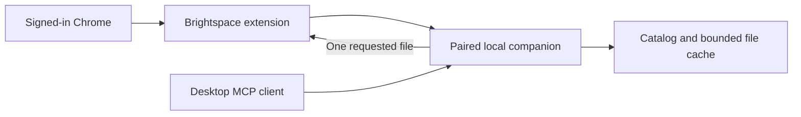

# Brightspace Context

Browse NYU Brightspace courses by semester and module, search resource titles and module notes, and retrieve individual course files through a paired local companion and desktop MCP client.

The Chrome extension uses the browser's existing Brightspace session. It keeps the course hierarchy locally and downloads files on demand. The publisher operates no hosted course-data service. This project is independent of NYU and D2L.

[Setup and Windows download](https://brightspace-context.khin101.chatgpt.site/setup/) · [Privacy policy](https://brightspace-context.khin101.chatgpt.site/) · [Roadmap](docs/ROADMAP.md) · [Release checklist](docs/RELEASE-CHECKLIST.md)

## Current status

The setup page offers Windows companion **0.10.1 beta** for Windows 10 and 11 x64 and links to Chrome extension **0.10.0** in the Chrome Web Store. The companion runs in the taskbar tray and provides a dashboard, guided Codex registration, optional launch at sign-in, and cache and retrieval controls.

The companion supports paged PDF, DOCX and PPTX reading, expiring local download links and isolated demo controls.

| Capability | Status |
| --- | --- |
| Semester/course discovery and nested module hierarchy | Implemented; live-tested in Chrome |
| Module notes, readings and links through MCP | Implemented; live-tested |
| Individual browser Download / Save as | Accessible NYU-hosted file formats supported |
| On-demand MCP retrieval and local cache | PDF, PPTX and DOCX supported |
| MCP semester discovery and catalog refresh | Live signed-in refresh verified with Resources closed; session-expiry retry covered by automated tests |
| PDF text reading | The live desktop connector read a complete 10-page PDF in two bounded responses |
| PPTX/DOCX text reading | Confirmed in the current desktop setup; original-byte integrity and format checks also pass automatically |

The companion dashboard can remove cached files and cancel queued retrievals. Account-switch isolation remains unfinished. This is a single-account local beta. Closing or disconnecting the browser does not erase saved companion data.

## Install the Windows preview

Follow the [public setup guide](https://brightspace-context.khin101.chatgpt.site/setup/). It provides the installer and SHA-256 checksum. The installer includes Node, the companion, the MCP server and an extension copy.

1. Install and start **Brightspace Context Companion** from the Start menu. It runs in the taskbar tray.
2. Install the Chrome extension from the setup guide's Chrome Web Store link. Keep one extension copy active.
3. Sign into NYU Brightspace in that Chrome profile and pair the extension with the companion's code.
4. Open **Browse resources**, select a semester and choose **Sync semester**.
5. Open **Open controls** from the tray menu, click **Connect to Codex**, then quit and reopen Codex. Other supported local MCP clients can use the installed guide's exact Command and Argument.

Ask the connected client to find a resource, retrieve it and read the actual file before answering. The companion provides a bounded PDF/Office text reader through MCP.

## Run from source

On Windows, use Node.js 22.13 or later and Chrome 116 or later.

```text
npm ci
npm run companion
```

Load this repository's `extension/` folder as an unpacked Chrome extension, sign into Brightspace and pair it with the source companion. Resources contains semester sync, course browsing, nested folders, notes, search and downloads.

For desktop MCP, configure a STDIO process using your Node executable and the absolute path to `mcp/start.js` as its argument. Run it on the same computer as the companion. `npm run mcp` starts that server for development; protocol messages use stdout, so it is not an interactive terminal command.

The updated MCP exposes `request_catalog_sync` and `get_catalog_sync`. A model can discover semesters, refresh one semester's course outlines and module notes, then search and request individual files without opening the extension UI. Chrome must be running with the paired extension and a valid Brightspace session. [Catalog-sync workflow and acceptance steps](docs/MCP-CATALOG-SYNC.md).

Searches match completed words and allow the final word to be unfinished, such as `if i ha` for “If I had…”. Single letters match standalone words. Notes match and highlight only passages containing all query terms; unrelated lines remain plain context. Only branches leading to relevant files or notes open automatically. A match in a folder's own title leaves it collapsed unless there is a deeper result. The deepest direct match gets soft row emphasis while ancestor folders remain visible for context.

## How it works



- **Catalog:** fixed NYU endpoints discover semesters, courses and recursive outlines. Descriptions already present are reused; missing module descriptions use the module metadata endpoint. Scanning does not expand webpage modules or bulk-download files.
- **Retrieval:** MCP resolves one stable catalog key and queues a request. The paired Chrome worker fetches it through its browser session. Passwords and cookie values are not read or exported to the companion.
- **Cache.** Each library has its own 500 MiB default budget. The cache keeps original PDF, PPTX and DOCX files up to 50 MiB each, checks freshness and SHA-256, and evicts the least recently used files when it needs space.
- **Handoff:** Prefer bounded, paged text reading for PDF, DOCX and PPTX. PDF uses its existing text layer; Office files use existing XML. No OCR or text index is created. Original bytes remain available through an MCP resource link. On explicit request, a five-minute localhost link lets the user download one cached original without a plaintext server copy. Clients requiring a path can use the separately enabled temporary-export feature. Module notes are available directly as source text.

The companion binds to `127.0.0.1:47653` and checks the paired extension origin and token. Browser pairing and desktop MCP registration are separate connections.

## Local data and privacy

Catalogs are stored in Chrome and the paired companion. The Windows cache defaults to `%USERPROFILE%\BrightspaceContext\cache`. Set `BRIGHTSPACE_CACHE_DIR` to the same absolute path in both the companion and MCP environments to use another directory. The Chrome extension connects on port `47653`.

The companion encrypts persistent data with AES-256-GCM and protects the key through your Windows account. Chrome keeps live credentials and keys in session memory and encrypts saved catalogs. When upgrading an older plaintext cache, the companion verifies encrypted copies before retiring the originals. After a full browser restart, start the companion to unlock saved catalogs. Unpaired browser catalogs last for the browser session.

Normal MCP retrieval creates no plaintext local path. Optional temporary exports are disabled by default, expire after 15 minutes and are removed on normal shutdown; a crash can leave them until the next start. Explicit localhost download links expire after five minutes or companion restart/re-pairing, are restricted to one file version and create no plaintext server file. Anyone with a link on the same computer can use it until expiry; opening it saves an ordinary browser download. User-requested Downloads remain separate ordinary files. The chosen AI client may receive metadata and requested files under its provider policies/settings. See [encrypted storage and handoff](docs/ENCRYPTED-STORAGE.md). The static setup/privacy website hosts installers and instructions, not course data. Live desktop-host acceptance remains a separate check from SDK transport tests.

Browser disconnect, companion uninstall and stopping the service preserve data. To remove companion data, stop it and explicitly remove its cache directory. Remove the extension or clear its storage separately. See the [privacy policy](https://brightspace-context.khin101.chatgpt.site/) for details. Use synthetic data in issues and screenshots.

## Reviewer demo

In the 0.10.0 beta Chrome ZIP, choose **Resources → Advanced → Demo and testing → Hosted demo**. Sync **Demo 2026 Fall** to browse and search fictional courses and download sample files without installing the companion or signing into NYU.

The companion serves a fictional LMS at `http://127.0.0.1:47653/demo/` for testing without an NYU account. Pair the extension and choose **Resources → Advanced → Demo and testing → Local demo**.

In Resources, sync **Demo 2026 Fall**. For demo MCP calls, use `provider: "demo"`. The demo has its own catalog, cache and request queue. [Demo walkthrough](docs/DEMO-LMS.md)

## Development and validation

```text
npm test
npm run check
npm run build:rich-text -- --check
npm run package:extension
```

`npm run build:rich-text` regenerates the checked-in parser/validator modules from `assets/`. Dependencies and notices are bundled locally; executable code is not loaded remotely. The extension ZIP uses an explicit browser-asset allowlist and excludes private data and developer-only inspection scripts.

Windows packaging requires the pinned build tools in [WINDOWS-INSTALLER.md](docs/WINDOWS-INSTALLER.md):

```text
npm run build:windows
npm run test:installer
```

The installer smoke check uses an isolated synthetic cache to verify the bundled runtime, pairing, file bytes through MCP and restart persistence. [Diagnostics](docs/COMPANION-LOGGING.md) and the verbose launcher help troubleshoot local connections.

The [roadmap](docs/ROADMAP.md) is generated from [editable JSON](docs/roadmap.json) and a [reusable schema](docs/roadmap.schema.json). Regenerate it with `npm run roadmap`.

## Contributing, support and license

See [CONTRIBUTING.md](CONTRIBUTING.md) for development and pull-request guidance and [SECURITY.md](SECURITY.md) for private vulnerability reports. General support: **khinaungwrk@gmail.com**. Never attach course files, pairing credentials or browser cookies to public issues.

The project code is licensed under [MIT](LICENSE). Third-party components retain their own licenses; browser dependency notices are in [THIRD-PARTY-LICENSES.txt](extension/THIRD-PARTY-LICENSES.txt). Course materials remain subject to their owners' rights and are not covered by this project's license.
