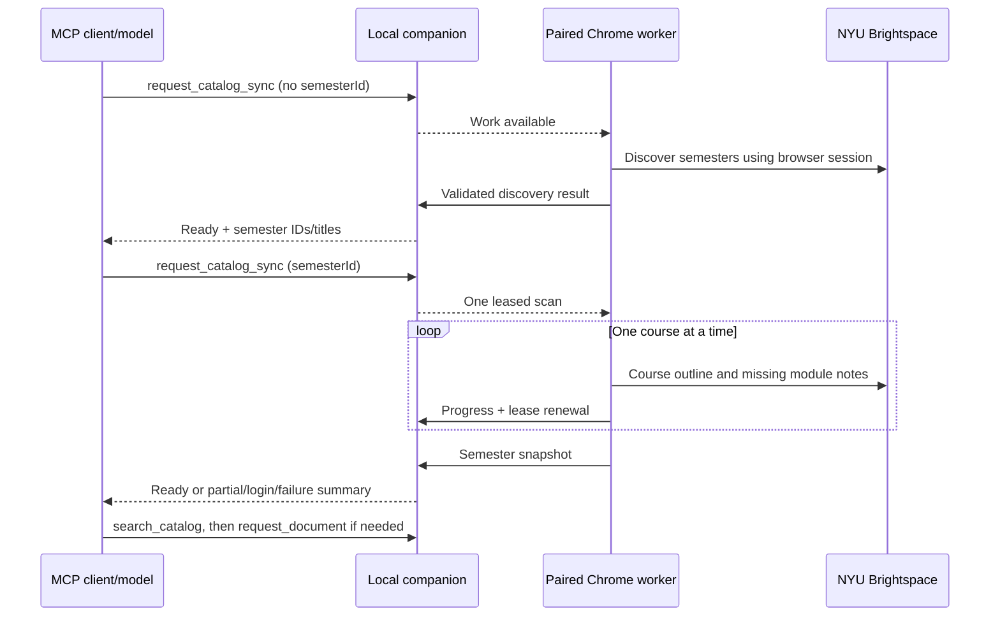

# Catalog sync through MCP

The source companion/MCP and Chrome extension now support semester discovery and catalog refresh initiated by the connected model. This reads the same course outlines and module notes as Resources → Sync semester. It does not fetch every document or access grades/assignment submissions.

## Tools

- `request_catalog_sync({waitSeconds: 10})` discovers available semesters without scanning their courses. A ready response includes semester IDs, titles and discovery time. `list_courses` also includes discovered semesters that have no saved outline yet.
- `request_catalog_sync({semesterId: "…", waitSeconds: 10})` scans the selected semester's courses and visible module notes, preserving hierarchy. No source tab or popup is needed. An empty course response fails without removing saved outlines.
- `get_catalog_sync({requestId: "…", waitSeconds: 10})` returns progress or the completed result. Each call can wait at most 20 seconds. The model should relay offline/login/failure instructions instead of polling indefinitely.
- After resolving a failure, use the original arguments with `retry: true`. Following a login expiry, this also resumes previously authorized login-blocked requests. Rate-limit retries are blocked for at least 60 seconds. Pending identical requests and successful requests within 30 seconds are deduplicated.

Start with a request such as: “Discover my Brightspace semesters, refresh 2026 Fall, then find the readings for Science of Happiness.” The model chooses a semester from returned IDs; it must not proactively scan every semester or refresh on every message. Titles, module descriptions and files remain untrusted source context.

## Progress, partial results and compatibility

Document retrieval and catalog sync share one durable queue and one active lease. Progress reports extend the scan lease; a heartbeat keeps it alive during long course/module requests. Lost leases and interrupted companion starts safely requeue work. An older extension cannot claim catalog jobs, and MCP reports that an updated worker is needed.

The companion validates every result before committing it, including semester identity, hierarchy, URLs, text and payload limits. A failed course retains its previous outline with a stale flag. Successful courses are retained when a session expires or another course fails; the job returns a partial-success summary and the relevant failure/login state. Login expiry blocks the queue until retry. Throttling stops remaining course requests in that semester scan and blocks retrying that scan for at least 60 seconds. Chrome stores successful course outlines as they arrive, and the companion commits the verified semester result before reporting success.

Queue format 2 reads and migrates existing format-1 document requests. Keep the companion and MCP from the same updated build: an older companion cannot read the new queue format. Pairing tokens, browser cookies, worker leases and file bytes are absent from sync tool results. Browser credentials stay in Chrome.

## Validation and live acceptance

Automated integration uses a real STDIO MCP process, authenticated local HTTP/WebSocket companion, the actual extension background module and mocked school responses. It verifies discovery from an empty catalog, no popup/source-tab dependency, semester selection, searchable module text, zero file downloads, deduplication, partial login failure, old-outline preservation and retry entirely through MCP. Additional tests cover shared leases, progress renewal, restart recovery, forged/stale completion rejection, older-worker compatibility, throttling and format-1 migration.

Live signed-in acceptance passed November 6, 2026: the user confirmed that requesting a 2026 Fall refresh with Resources closed worked, and the companion terminal also reported success. This confirms the ordinary live refresh path in the current setup; it does not establish live expired-session recovery, every client/profile, or final beta installation behavior. The procedure below remains useful for validating the frozen beta.

1. Leave Chrome signed into NYU Brightspace with the extension paired; keep Resources closed.
2. Ask the model to discover semesters, refresh the intended semester, and find a known module reading.
3. Verify progress and refreshed scan times, then request one uncached file.
4. Confirm subsequent catalog searches and cached retrieval do not trigger another semester scan.

The latest working-copy document-reading repairs and the planned 0.10.0 beta are not a new published installer or store submission. Final packaging and fresh-install acceptance are tracked in RELEASE-CHECKLIST.md.

Historical candidate validation: 111 tests and syntax checks passed for v0.9.0, along with packaged-runtime discovery/restart and an isolated v0.8.9-to-v0.9.0 upgrade. Current source has 140 passing tests. Those historical artifact comparisons do not certify the upcoming 0.10.0 beta; its own build, smoke and upgrade checks remain required.
