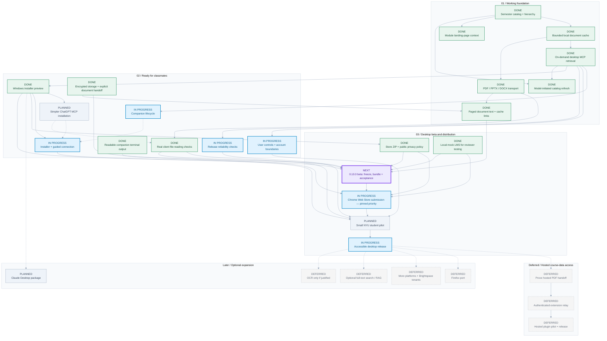

# Brightspace Context - Development Roadmap

Local Windows/NYU retrieval is accepted as the current MVP baseline on November 6, 2026: semester hierarchies, module notes, on-demand original files, encrypted bounded caches and paged PDF/DOCX/PPTX text reading. The actual desktop connector read all 10 pages of a real PDF in two bounded responses; remaining client/format and live refresh checks are tracked explicitly. Public artifacts remain companion 0.9.4 and extension 0.9.3; installed working-copy repairs are not a frozen release. Next: prepare and validate the requested 0.10.0 beta, then finish the existing Chrome Web Store submission. Simpler MCP installation, tray/startup, client/platform expansion and a student pilot follow; hosted course-data deployment, indexing/RAG and OCR remain deferred.

**13 done | 6 in_progress | 1 next | 3 planned | 0 research | 7 deferred**

> Editable source: [roadmap.json](roadmap.json). Reusable structure: [roadmap.schema.json](roadmap.schema.json). Regenerate with `npm run roadmap`.

**Reading the chart:** green = completed with evidence; sky blue = partly implemented; purple = recommended next; blue-gray = planned; amber = research; dashed gray = deferred. Solid arrows are prerequisites. Dashed arrows are optional follow-ups, not release blockers. No dates or effort estimates are implied.

## Update or reuse

1. Edit milestones in `roadmap.json`: keep each `id` stable, set its `status`, and describe its deliverable and acceptance criteria.
2. Add phases or dependencies as needed. Every edge references milestone IDs; the generator rejects missing references, duplicate edges and cycles.
3. Run `npm run roadmap`. Commit the source and regenerated files together.
4. For another project, copy the JSON/schema and run `node scripts/generate-roadmap.js path/to/roadmap.json output-directory`.

The schema supports editor validation. The generator performs structural and graph checks without adding project dependencies. The `.mmd` output can be used directly in Mermaid-compatible tools.

## 01 / Working foundation

### Semester catalog + hierarchy - DONE

Discover semesters and courses inside Resources, preserve all accessible nested modules and stable resource IDs, and expose catalog search through MCP.

Acceptance:

- A desktop chat can locate Science of Happiness readings across a synced semester without downloading every file.

Evidence:

- User confirmed 5/5 courses synced from Resources without navigating Brightspace tabs.
- A separate desktop chat located Science of Happiness readings.
- Inline Download and Save as support accessible NYU-hosted files across formats.

### Bounded local document cache - DONE

Pair Chrome with the local companion and cache individual PDF, PPTX and DOCX files with freshness checks, SHA-256 verification, a 500 MiB LRU budget per isolated NYU/demo library and a 50 MiB per-file limit.

Acceptance:

- First requests fetch original file bytes; repeats use the verified cache.
- Old PDF cache entries remain usable after adding Office formats.

Evidence:

- Chrome PDF first-fetch/cache-hit behavior confirmed live.
- Automated Office transport, invalid-package rejection, cache restart and PDF compatibility tests pass.
- The v0.8.8 packaged runtime passed PDF/PPTX/DOCX byte-equality, MIME-type and restart checks.

Prerequisites: Semester catalog + hierarchy.

### On-demand desktop MCP retrieval - DONE

Connect catalog requests to a durable queue, the signed-in Chrome worker and verified original files; answer content questions through bounded text pages without a default plaintext export.

Acceptance:

- A chat can request one catalogued file and receive verified original bytes, correct MIME/extension and an explicit reading route.
- PDF answers use actual document text; offline/login/failure states provide recovery steps. Normal retrieval creates no plaintext server file.

Evidence:

- Live uncached PDF fetch, document reading and repeat cache hits were verified through desktop MCP.
- The refreshed live connector read a real 10-page PDF completely: 20,454 characters in two responses, with no empty text pages and no plaintext export. User confirmed it works.
- 140 source tests pass, including browser-worker/cache/MCP integration, ordered Office text, PDF pagination, parser limits, expiring links and encrypted-storage recovery.

Prerequisites: Bounded local document cache.

### Model-initiated catalog refresh - DONE

Discover semesters and refresh one semester through durable MCP requests and the paired Chrome worker, without opening Resources.

Acceptance:

- A connected desktop model refreshes a live semester and searches its current readings with Resources closed.
- Expired sessions preserve partial results and resume through MCP after browser sign-in.

Evidence:

- Real STDIO MCP, authenticated companion/WebSocket and actual extension background integration tests pass with synthetic school responses.
- Shared leases, progress renewal, deduplication, rate limiting, login retry, pause at module boundaries and version-one queue migration are tested.
- November 6, 2026: user confirmed the requested live 2026 Fall refresh with Resources closed worked, and the companion terminal also reported success. No course count or refreshed timestamp was captured in this confirmation.
- Live signed-in refresh is accepted in the current setup. Session-expiry/partial-result retry has automated integration evidence; a live expired-session exercise is not claimed.

Prerequisites: Semester catalog + hierarchy; On-demand desktop MCP retrieval.

### PDF / PPTX / DOCX transport - DONE

Retrieve and cache original PDF, PPTX and DOCX files and return the correct extension and MIME type through MCP, without OCR or conversion.

Acceptance:

- Each format passes fetch, cache-hit, byte-equality and restart checks.
- Malformed/mismatched Office containers and login HTML do not become cached documents.

Evidence:

- 80 local tests passed, including full PPTX and DOCX browser-worker/MCP flows.
- The final Windows payload passed PDF/PPTX/DOCX handoff checks using its bundled runtime.
- The real Adolescence and Peers Fall 26 CC deck is recognized as a supported PPTX. The user separately confirmed live PPTX reading on November 6; the acceptance report did not name the tested deck.

Prerequisites: Bounded local document cache.

### Module landing-page context - DONE

Preserve module descriptions, readings, film references and links in the local catalog and return them through MCP; expose collapsed Module notes in Resources.

Acceptance:

- The real Topic 9 module text is visible in Resources and returned by MCP with its source URL.

Evidence:

- User confirmed the readings and Me, Earl and the Dying Girl appear in Module notes.
- A fresh MCP process returned the actual Topic 9 reading list, film reference and module URL.
- v0.8.8 search highlighting was verified in standalone Chrome: matching notes open with highlighted text and direct-match counts; the deepest filename match receives row emphasis.

Prerequisites: Semester catalog + hierarchy.

### Paged document text + cache links - DONE

Read existing PDF text layers and Word/PowerPoint XML in small checksum-bound pages; provide explicit expiring local download links to originals.

Acceptance:

- Supported formats have bounded original-text reading without OCR, host-installed parsers or default plaintext exports.
- Pagination is explicit and detects document changes; original-byte access remains available for visual or unsupported content.
- The actual desktop connector reads a complete real PDF; remaining client/format checks stay tracked separately.

Evidence:

- 140 tests pass. PDF parsing has worker deadlines/heap limits, bounded concurrent work, page/text limits and no runtime network fetching.
- The live connector read all 10 pages of a real PDF in two responses; the user accepted the retrieval pipeline. Real Word text was also read through MCP.
- Expiring links return byte-identical originals, bind to provider/file version/pairing and expire or revoke without a plaintext server file. PDF visual layout/images and scanned pages remain outside text-only coverage.

Prerequisites: PDF / PPTX / DOCX transport; Encrypted storage + explicit document handoff.

## 02 / Ready for classmates

### Companion lifecycle - IN PROGRESS

Provide start/stop controls, optional startup on sign-in, visible connection health and clean recovery after reboot or companion restart.

Acceptance:

- A user can start and recover the companion without a terminal.
- Restarting the computer preserves pairing, catalog and cache, and retrieval resumes when enabled.

Evidence:

- Installed Start menu launcher, timestamped diagnostics, verbose mode and browser reconnect/recovery are implemented.
- Tray controls, optional startup on sign-in and full reboot acceptance remain pending.

Prerequisites: On-demand desktop MCP retrieval.

### Installer + guided connection - IN PROGRESS

Guide companion installation, browser installation/pairing and desktop MCP setup, with an end-to-end verification step and supported update/uninstall instructions.

Acceptance:

- A classmate installs on a fresh Windows account without Node, source checkout or shell commands.
- The setup flow verifies browser sign-in, companion connection and one retrieved PDF.

Evidence:

- Versioned Windows installers, Start menu launcher, pairing code, guided setup and update/uninstall instructions are implemented.
- Fresh-install testing exposed confusing extension identities and stale MCP processes. Browser-store installation and manual MCP setup must be checked against the final beta.
- Chrome loading and MCP registration are still manual before distribution improvements. Fresh-account/classmate onboarding remains unverified.

Prerequisites: Windows installer preview.

### User controls + account boundaries - IN PROGRESS

Add course selection, cache inspection/deletion, disconnect controls and cancellation; define browser-profile and Brightspace-account isolation.

Acceptance:

- A user can inspect and remove stored course data, pause retrieval, cancel queued work and revoke pairing.
- Changing school accounts does not silently reuse another account's catalog or documents.

Evidence:

- Course browsing/selection, automatic-retrieval pause/resume, browser disconnect and pairing reset are implemented.
- Cache inspection/deletion, queued-request cancellation and explicit Brightspace-account isolation remain incomplete.

Prerequisites: On-demand desktop MCP retrieval.

### Release reliability checks - IN PROGRESS

Exercise the existing recovery behavior across real session expiry, course changes, permission loss, restarts and multiple tabs/profiles; improve actionable errors.

Acceptance:

- Signed-out, inaccessible, changed and unsupported resources produce clear recovery steps.
- A fresh-profile check covers scan, fetch, read, repeat and restart without mixing courses.

Evidence:

- 140 source tests cover existing retrieval, PDF/Office text reading, byte integrity, paging, parser limits, demo isolation, pairing, queue recovery and encrypted-storage behavior.
- Published 0.9.4 passed packaged-runtime smoke and an isolated upgrade from 0.9.3. The final 0.10.0 bundle still needs its own smoke/upgrade checks.
- Live PowerPoint reading and MCP semester refresh with Resources closed are user-confirmed. Final beta fresh-install, reboot and multi-profile checks remain separate release acceptance work.

Prerequisites: On-demand desktop MCP retrieval.

### Windows installer preview - DONE

Provide a Windows x64 installer with pinned Node, production dependencies, a companion launcher, setup guide and uninstall support.

Acceptance:

- The packaged runtime starts, pairs, serves supported cached files through MCP and preserves them across restart.

Evidence:

- Published Windows companion 0.9.4 bundles its pinned Node runtime, production dependencies, MCP, companion and unpacked extension.
- Packaged-runtime smoke and isolated 0.9.3-to-0.9.4 upgrade checks passed; installer hashes and immutable release records are retained.
- Installed UI and document-reading working copies were patched with rollback records. The 0.10.0 beta installer is not built yet.

Prerequisites: On-demand desktop MCP retrieval.

### Simpler ChatGPT MCP installation - PLANNED

Package the existing MCP server for supported local ChatGPT plugin installation and guide users through installation and connection.

Acceptance:

- A fresh installation can register the local MCP without manually entering executable paths.
- ChatGPT discovers tools and retrieves a file using the existing paired browser and shared companion.

Evidence:

- Supported local-plugin installation was researched; the package and installer integration are not implemented yet.
- Public ChatGPT local-plugin distribution has separate eligibility/review requirements; local packaging is not public directory approval.
- Chrome Web Store submission is the pinned priority. Automatic MCP setup is a follow-up improvement; document the working manual setup for the initial release.

Prerequisites: Windows installer preview.

### Real client file-reading checks - DONE

Record actual file-reading evidence for PDF, PPTX and DOCX in the current Windows desktop setup, using bounded local text tools and original-file fallback where visual inspection is needed.

Acceptance:

- A real PPTX is retrieved and its slide content is read in the supported desktop chat.
- A real DOCX is retrieved/read and repeated requests use the cache.
- The current Windows desktop setup has actual PDF, PPTX and DOCX reading evidence; other clients require their own acceptance checks.

Evidence:

- Live desktop PDF text reading is confirmed through the actual connector, including complete continuation across two responses.
- A real DOCX syllabus was read through the connector and installed-runtime checks; its original checksum and grading text were verified.
- November 6, 2026: user confirmed that live PPTX reading works. The tested deck title was not specified; this does not claim the named example deck, Claude or every desktop client was tested.

Prerequisites: PDF / PPTX / DOCX transport.

### Readable companion terminal output - DONE

Make ordinary companion output concise and readable, while retaining useful detail in verbose mode.

Acceptance:

- Normal output summarizes connection, sync and retrieval outcomes without flooding the terminal with IDs and repeated events.
- Login, failure and recovery actions remain clear; verbose mode retains structured diagnostic detail without exposing credentials or course contents.

Evidence:

- Compact normal logs, separate NYU/demo labels, useful sync/cache outcomes and actionable errors are implemented. Verbose mode retains structured diagnostics without file contents or credentials.
- Published companion 0.9.4 includes the change; packaged-runtime smoke and isolated 0.9.3-to-0.9.4 upgrade checks passed.

### Encrypted storage + explicit document handoff - DONE

Protect persistent companion and browser data with Windows-protected keys; read requested bytes/text in memory, gate temporary plaintext exports separately, and scope user-requested download links to one file version.

Acceptance:

- Verified migration preserves catalogs, original document bytes, pairing and pending requests.
- No plaintext path or persistent browser bearer/key is produced by normal retrieval.
- Packaged-runtime and installed-upgrade checks pass; live client acceptance is recorded separately.

Evidence:

- 128 source tests pass, including native key protection, corruption/key-loss/access-error preservation, origin-bound browser unlocking, port-before-migration startup and export revocation.
- The encrypted Windows runtime and isolated 0.9.1-to-0.9.2 migration/upgrade passed; historical artifact verification is recorded in store/RELEASE-0.9.2.md. Subsequent installed working-copy and live retrieval checks are recorded separately.
- Matching v0.9.2 public installer, setup guide and versioned privacy policy published as site version 6; the public installer SHA-256 matches the frozen tested artifact.
- Installed and live connector checks verified original cached bytes and bounded text reading without a plaintext server copy. Explicit five-minute download capabilities and separately enabled 15-minute filesystem exports retain different lifetimes and disclosures.

## 03 / Desktop beta and distribution

### Small NYU student pilot - PLANNED

Invite 3-5 classmates with different courses and observe installation and document retrieval; collect consented, redacted bug reports.

Acceptance:

- Participants complete setup and retrieve/read their own supported course files without developer assistance.
- Pilot failures are recorded and resolved before broad distribution.

Prerequisites: Installer + guided connection; User controls + account boundaries; Release reliability checks; Real client file-reading checks; Chrome Web Store submission — pinned priority.

### Accessible desktop release - IN PROGRESS

Prepare versioned installers, extension distribution, desktop plugin packaging, privacy disclosures, permission explanations and support instructions; complete applicable reviews.

Acceptance:

- A new user can follow a public installation guide and reach a successful document answer without terminal commands.
- Update, uninstall, data deletion and supported-platform boundaries are documented and verified.

Evidence:

- Versioned Windows preview installers, a validated Chrome Web Store ZIP, icons, listing drafts and a public privacy policy are prepared.
- Public setup and checksum-verified installer downloads are available. Store upload/approval and the classmate pilot remain pending.

Prerequisites: Small NYU student pilot.

### Store ZIP + public privacy policy - DONE

Prepare a minimal browser ZIP, local readable JavaScript bundles, icons, listing/permission drafts and a public policy matching local file handling.

Acceptance:

- ZIP integrity and local dependency checks pass without including private runtime/course files.
- The privacy policy is publicly readable and covers PDF/PPTX/DOCX handling.

Evidence:

- A validated 34-entry extension 0.9.3 ZIP, icons, synthetic screenshots, publisher/support details, permission answers and public privacy/setup/reviewer pages exist.
- Public companion 0.9.4 downloads are checksum-verified. Public source is MIT-licensed.
- Final beta assets, text-reading/download-link disclosures, demo navigation instructions and download URLs must match the frozen 0.10.0 candidate before upload.

Prerequisites: Windows installer preview.

### 0.10.0 beta: freeze, bundle + acceptance - NEXT

Freeze current UI, demo, encrypted storage, logging and paged document-reading changes into matching 0.10.0 beta artifacts; verify the actual release build before publishing it.

Acceptance:

- Version metadata, source checkpoint, extension ZIP, Windows installer and artifact hashes all identify the final candidate.
- Isolated packaged-runtime smoke and 0.9.4-to-beta upgrade preserve encrypted data and verify text reading through bundled production dependencies.
- Fresh-install Chrome/desktop checks cover pairing, demo and NYU sync/search, supported file reading/downloads, cache hits and restart. Supported-format reading and live MCP semester refresh are already verified in the current setup.
- Public setup/reviewer/privacy material and store screenshots match the final build; reviewers can test the local demo without institutional credentials.

Evidence:

- Requested public milestone: 0.10.0 beta, replacing alpha/preview status after fresh-install acceptance. No version bump or new public artifact is claimed yet.
- Current public artifacts are companion 0.9.4 and extension 0.9.3. Installed working copies include newer review patches; rebuilding published versioned artifacts in place would not produce an auditable beta.
- PDF, DOCX and user-confirmed PPTX reading are accepted in the current desktop setup. The frozen beta will still receive its own installation and upgrade checks.
- November 6: user confirmed live semester refresh with Resources closed and a successful companion-terminal result. The remaining next step is freezing and validating the beta artifacts.

Prerequisites: Paged document text + cache links; Windows installer preview; Local mock LMS for reviewer testing; Readable companion terminal output; Store ZIP + public privacy policy; Real client file-reading checks.

### Chrome Web Store submission — pinned priority - IN PROGRESS

Complete final live acceptance and dashboard fields, disclose the NYU access limitation, and submit an unlisted pilot listing.

Acceptance:

- All required listing/privacy/reviewer fields and assets are complete.
- A real listing URL is approved and used by onboarding, allowing Chrome installation without Developer mode.

Evidence:

- Chrome developer registration is confirmed. Existing draft item: iadmhandkbomngnaplppiopojmfkcodi; last recorded upload was 0.9.1. No submission or approval is claimed.
- The local reviewer demo and encrypted storage are implemented. Final beta packaging, live acceptance, matching listing material and dashboard validation remain before submission.
- Chrome publishing remains pinned. Submit the final candidate to the existing draft; optional tray, automated MCP setup, Claude, Firefox and indexing must not delay it.

Prerequisites: Store ZIP + public privacy policy; Encrypted storage + explicit document handoff; Local mock LMS for reviewer testing; 0.10.0 beta: freeze, bundle + acceptance.

### Local mock LMS for reviewer testing - DONE

Serve fictional semester/course/module metadata and sample PDF/PPTX/DOCX files from the companion; exercise the production parsing, sync and MCP pipeline through a clearly labelled demo source.

Acceptance:

- Reviewers can sync, search, download, resync and retrieve sample documents without NYU credentials.
- Demo and NYU catalog/cache identities remain separate, with fixed source validation.
- Instructions state that demo testing does not verify real NYU authentication.

Evidence:

- Published companion 0.9.3/0.9.4 serves the fictional LMS and original PDF/PPTX/DOCX fixtures locally, with nested modules, module notes, resync changes and simulated session expiry.
- Production HTTP/background/MCP integration tests verify demo versus NYU isolation, including colliding numeric IDs and cached reads while offline. Public reviewer instructions disclose the limits.
- Demo selection is tucked into Resources > Advanced > Demo and testing in the source and installed working copy. Final 0.10.0 fresh-install acceptance remains part of the beta release milestone.

## Deferred / Hosted course-data access

### Prove hosted PDF handoff - DEFERRED

Validate one authenticated PDF transfer into the intended hosted ChatGPT surface and confirm the model can read the actual document.

Acceptance:

- A hosted chat answers from a test PDF without relying on a local filesystem path or a metadata-only link.
- Document delivery, consent, retention and client support are understood before selecting the cloud architecture.

Evidence:

- Deferred by the user: prioritize local installation and avoid operating a hosted course-data service. The static public privacy website hosts no course data.

### Authenticated extension relay - DEFERRED

Design and implement user/device authentication, isolated catalogs and queues, a secure browser connection and bounded document retention using the validated handoff.

Acceptance:

- Two test users cannot access each other's catalog, requests or files.
- Brightspace session credentials remain in each user's browser; device disconnect and deletion work.

Evidence:

- Deferred by the user: prioritize local installation and avoid operating a hosted course-data service. The static public privacy website hosts no course data.

Prerequisites: Prove hosted PDF handoff.

### Hosted plugin pilot + release - DEFERRED

Package the hosted integration for the chosen ChatGPT surface; validate access requirements, cost, review and support with a small pilot.

Acceptance:

- A supported hosted chat can discover and read a user's requested course PDF through the complete authenticated flow.
- Operational limits, costs, retention and publication requirements have been tested and documented.

Evidence:

- Deferred by the user: prioritize local installation and avoid operating a hosted course-data service. The static public privacy website hosts no course data.

Prerequisites: Authenticated extension relay.

## Later / Optional expansion

### Firefox port - DEFERRED

Adapt background execution, browser APIs, absolute request URLs and moz-extension origin pairing; package and test Firefox support.

Acceptance:

- Firefox passes scan, fetch, PDF read, cache repeat, sign-in recovery and popup-closed retrieval checks using its own session.

### More platforms + Brightspace tenants - DEFERRED

Expand installer/desktop support and parameterize tenant hosts and verified API behavior as demand justifies.

Acceptance:

- Each advertised OS and tenant has installation and end-to-end retrieval evidence; unsupported configurations remain explicit.

### Optional full-text search / RAG - DEFERRED

Evaluate document indexing, chunk search or embeddings against pilot needs, using existing on-demand PDF/Office text reading as the baseline. Text extraction itself is implemented; no persistent text index or RAG pipeline exists.

Acceptance:

- A measured evaluation demonstrates improved document discovery or context efficiency without requiring OCR.

### OCR only if justified - DEFERRED

Evaluate an explicit opt-in path for image-only documents if users need searchable text and the cost/quality tradeoff is acceptable.

Acceptance:

- Measured accuracy, latency, storage and compute costs justify the feature; OCR is not required for the core PDF handoff.

### Claude Desktop package - PLANNED

Bundle the existing MCP as a Claude Desktop MCPB and reuse the paired Chrome extension, companion and cache.

Acceptance:

- A fresh Claude installation discovers the MCP tools and retrieves a supported file.
- Actual PDF/PowerPoint/Word reading behavior is verified and unsupported host readers are clearly reported.

Evidence:

- The MCPB installation route was researched; no Claude package or live Claude test has been completed.
- This is an optional client expansion, not a prerequisite for the first ChatGPT pilot.
