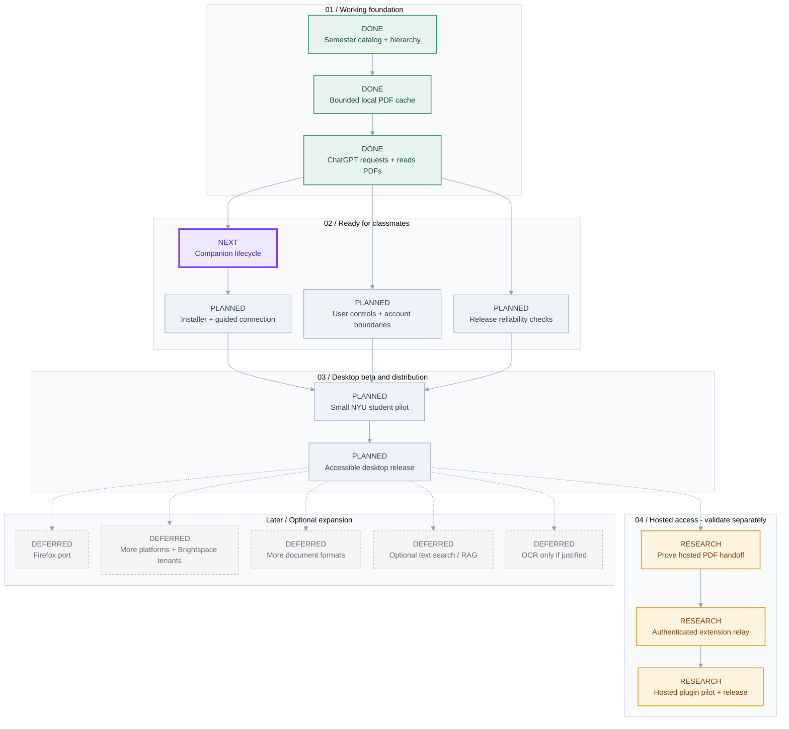

# Brightspace Context - Development Roadmap

Working baseline: NYU Brightspace, Chrome/Chromium, supported NYU-hosted PDFs, and desktop MCP. Goal: make the proven retrieval flow easy for other students to install and use.

**3 done | 1 next | 5 planned | 3 research | 5 deferred**

> Editable source: [roadmap.json](roadmap.json). Reusable structure: [roadmap.schema.json](roadmap.schema.json). Regenerate with `npm run roadmap`.

**Reading the chart:** green = working; purple = recommended next; blue-gray = planned; amber = needs validation; dashed gray = deferred. Solid arrows are prerequisites. Dashed arrows are optional follow-ups, not release blockers. No dates or effort estimates are implied.

## Update or reuse

1. Edit milestones in `roadmap.json`: keep each `id` stable, set its `status`, and describe its deliverable and acceptance criteria.
2. Add phases or dependencies as needed. Every edge references milestone IDs; the generator rejects missing references, duplicate edges and cycles.
3. Run `npm run roadmap`. Commit the source and regenerated files together.
4. For another project, copy the JSON/schema and run `node scripts/generate-roadmap.js path/to/roadmap.json output-directory`.

The schema supports editor validation. The generator performs structural and graph checks without adding project dependencies. The `.mmd` output can be used directly in Mermaid-compatible tools.

## 01 / Working foundation

### Semester catalog + hierarchy - DONE

Discover the selected semester's courses and preserve nested modules, resource metadata and stable IDs; expose catalog search through MCP.

Acceptance:

- A desktop chat can locate Science of Happiness readings across a synced semester without downloading every file.

Evidence:

- Semester sync and cross-course catalog discovery confirmed in a separate desktop chat.
- Inline download and Save as controls work in standalone Chrome.

### Bounded local PDF cache - DONE

Pair the extension with the companion and cache individual PDFs with version checks, integrity verification and LRU eviction.

Acceptance:

- A first request fetches the PDF; repeating it uses the verified local copy.

Evidence:

- First-fetch and cache-hit behavior confirmed in Chrome; cache, authentication and quota integration checks pass.

Prerequisites: Semester catalog + hierarchy.

### ChatGPT requests + reads PDFs - DONE

Connect MCP requests to a durable queue, the signed-in Chrome worker and a verified local PDF handoff.

Acceptance:

- A chat finds an uncached PDF, requests it, waits for ready, reads its actual contents and can reuse the cache.

Evidence:

- Live uncached syllabus fetch and cache repeat verified through MCP.
- A separate chat successfully requested a different Science of Happiness reading.
- 37 automated checks passed at the retrieval milestone; GitHub CI passed.

Prerequisites: Bounded local PDF cache.

## 02 / Ready for classmates

### Companion lifecycle - NEXT

Provide start/stop controls, optional startup on sign-in, visible connection health and clean recovery after reboot or companion restart.

Acceptance:

- A user can start and recover the companion without a terminal.
- Restarting the computer preserves pairing, catalog and cache, and retrieval resumes when enabled.

Evidence:

- Timestamped companion diagnostics and a verbose troubleshooting launcher are implemented. Tray controls, optional startup and full reboot acceptance remain pending.

Prerequisites: ChatGPT requests + reads PDFs.

### Installer + guided connection - PLANNED

Bundle the runtime, guide extension pairing and desktop MCP setup, and provide a supported update/uninstall path.

Acceptance:

- A classmate installs on a fresh Windows account without Node, source checkout or shell commands.
- The setup flow verifies browser sign-in, companion connection and one retrieved PDF.

Evidence:

- Initial Windows x64 installer build includes a pinned Node runtime, production dependencies, Start menu launcher, setup guide and uninstall support. Packaged-runtime smoke coverage exercises isolated pairing, PDF handoff and restart persistence. Full fresh-account onboarding acceptance is still pending.

Prerequisites: Companion lifecycle.

### User controls + account boundaries - PLANNED

Add course selection, cache inspection/deletion, disconnect controls and cancellation; define browser-profile and Brightspace-account isolation.

Acceptance:

- A user can inspect and remove stored course data, pause retrieval, cancel queued work and revoke pairing.
- Changing school accounts does not silently reuse another account's catalog or documents.

Prerequisites: ChatGPT requests + reads PDFs.

### Release reliability checks - PLANNED

Exercise the existing recovery behavior across real session expiry, course changes, permission loss, restarts and multiple tabs/profiles; improve actionable errors.

Acceptance:

- Signed-out, inaccessible, changed and unsupported resources produce clear recovery steps.
- A fresh-profile check covers scan, fetch, read, repeat and restart without mixing courses.

Prerequisites: ChatGPT requests + reads PDFs.

## 03 / Desktop beta and distribution

### Small NYU student pilot - PLANNED

Invite 3-5 classmates with different courses and observe installation and document retrieval; collect consented, redacted bug reports.

Acceptance:

- Participants complete setup and retrieve their own course PDFs without developer assistance.
- Pilot failures are recorded and resolved before broad distribution.

Prerequisites: Installer + guided connection; User controls + account boundaries; Release reliability checks.

### Accessible desktop release - PLANNED

Prepare versioned installers, extension distribution, desktop plugin packaging, privacy disclosures, permission explanations and support instructions; complete applicable reviews.

Acceptance:

- A new user can follow a public installation guide and reach a successful document answer without terminal commands.
- Update, uninstall, data deletion and supported-platform boundaries are documented and verified.

Prerequisites: Small NYU student pilot.

## 04 / Hosted access - validate separately

### Prove hosted PDF handoff - RESEARCH

Validate one authenticated PDF transfer into the intended hosted ChatGPT surface and confirm the model can read the actual document.

Acceptance:

- A hosted chat answers from a test PDF without relying on a local filesystem path or a metadata-only link.
- Document delivery, consent, retention and client support are understood before selecting the cloud architecture.

### Authenticated extension relay - RESEARCH

Design and implement user/device authentication, isolated catalogs and queues, a secure browser connection and bounded document retention using the validated handoff.

Acceptance:

- Two test users cannot access each other's catalog, requests or files.
- Brightspace session credentials remain in each user's browser; device disconnect and deletion work.

Prerequisites: Prove hosted PDF handoff.

### Hosted plugin pilot + release - RESEARCH

Package the hosted integration for the chosen ChatGPT surface; validate access requirements, cost, review and support with a small pilot.

Acceptance:

- A supported hosted chat can discover and read a user's requested course PDF through the complete authenticated flow.
- Operational limits, costs, retention and publication requirements have been tested and documented.

Prerequisites: Authenticated extension relay.

## Later / Optional expansion

### Firefox port - DEFERRED

Adapt background execution, browser APIs, absolute request URLs and moz-extension origin pairing; package and test Firefox support.

Acceptance:

- Firefox passes scan, fetch, PDF read, cache repeat, sign-in recovery and popup-closed retrieval checks using its own session.

### More platforms + Brightspace tenants - DEFERRED

Expand installer/desktop support and parameterize tenant hosts and verified API behavior as demand justifies.

Acceptance:

- Each advertised OS and tenant has installation and end-to-end retrieval evidence; unsupported configurations remain explicit.

### More document formats - DEFERRED

Prioritize common course formats beyond PDF and define safe download, cache and model-reading behavior for each.

Acceptance:

- Each supported format can be requested and actually read by the target chat host, with size and content checks.

### Optional text search / RAG - DEFERRED

Evaluate lightweight extraction of existing PDF text and retrieval quality against real pilot needs and operating cost.

Acceptance:

- A measured evaluation demonstrates improved document discovery or context efficiency without requiring OCR.

### OCR only if justified - DEFERRED

Evaluate an explicit opt-in path for image-only documents if users need searchable text and the cost/quality tradeoff is acceptable.

Acceptance:

- Measured accuracy, latency, storage and compute costs justify the feature; OCR is not required for the core PDF handoff.
